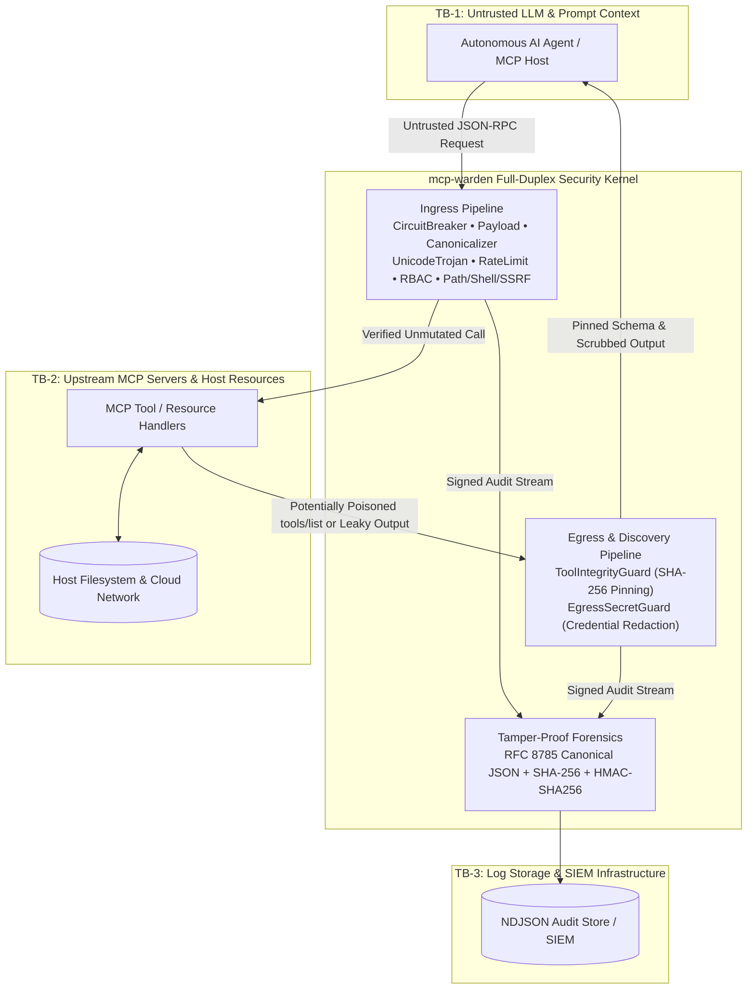

# Threat Model — `mcp-warden` (v1.1.0)

This document defines the security boundaries, adversary capabilities, **STRIDE** threat mitigations, **OWASP Top 10 for LLM Applications** coverage, and residual operational risks for `mcp-warden`.

---

## 1. System Context & Trust Boundaries

`mcp-warden` operates as an inline, deterministic security kernel positioned between an untrusted AI Agent / MCP Host runtime and downstream Model Context Protocol (MCP) tool/resource servers.

### Defined Trust Boundaries

- **`TB-1` (Untrusted Agent Invocation Boundary):** Every incoming JSON-RPC 2.0 `tools/call`, `resources/read`, and `prompts/get` payload is treated as potentially attacker-controlled via indirect prompt injection.
- **`TB-2` (Upstream MCP Server Boundary):** Third-party or remote MCP servers may serve poisoned tool descriptions, mutate `tools/list` schemas mid-session (Rug-Pull), or inadvertently return raw secrets inside legitimate log/file outputs.
- **`TB-3` (Audit Storage Boundary):** Local disk or log transport layers may be exposed to post-compromise tampering, deletion, or tail-truncation attempts.

---

## 2. STRIDE Threat Matrix

| STRIDE Category | Concrete MCP Attack Scenario | `mcp-warden` Countermeasure | Primary Module |
| :--- | :--- | :--- | :--- |
| **Spoofing** | Unauthenticated or low-privilege agent role invokes administrative tools; upstream server swaps tool behavior under an approved tool name. | Fail-closed role matching (`Explicit DENY > ALLOW`) + SHA-256 `tools/list` catalog pinning (`TOFU` and static hashes). | `PolicyEngine`, `ToolIntegrityGuard` |
| **Tampering** | Attacker modifies stored audit logs from `DENY` to `ALLOW`, deletes mid-stream entries, or rewrites chain from Genesis (`sequence: 0`). | Sequential SHA-256 links over RFC 8785 sorted JSON + secret-keyed Web Crypto `HMAC-SHA256` signatures & count/head anchors. | `hash-chain.ts`, `hmac-signer.ts` |
| **Repudiation** | Compromised agent session performs reconnaissance without forensic attribution. | Concurrency-serialized audit sealing recording `principalId`, `sessionId`, `requestId`, latency, and scrubbed arguments on every decision. | `AuditLogger`, `ndjson-codec.ts` |
| **Information Disclosure** | Double-encoded `..%252f.env` traversal; Cloud IMDS SSRF (`[::ffff:169.254.169.254]`); accidental AWS/GitHub/PEM key leak in tool output; verbose error path leaks. | Multi-pass canonicalizer, lexical Root-Jail, bitwise IPv4/IPv6 CIDR filter, outbound `EgressSecretGuard`, and sanitized JSON-RPC errors. | `PathTraversalGuard`, `SsrfGuard`, `EgressSecretGuard`, `WardenError` |
| **Denial of Service** | Deeply nested JSON bombs, million-key payloads, catastrophic regex backtracking (ReDoS), or high-rate probing loops. | Iterative heap-stack `PayloadGuard`, zero dynamic `RegExp` ($O(n)$ glob/span scanners), LRU-bounded `SlidingWindowRateLimiter`, and `SessionCircuitBreaker`. | `PayloadGuard`, `rate-limiter.ts`, `circuit-breaker.ts` |
| **Elevation of Privilege** | Shell subshell chaining (`$()`, `` ` ``, `;`, `|`), Trojan Source Bidi overrides (`U+202E`), or invisible Plane 14 tag smuggling (`U+E0000..U+E007F`). | Context-aware `CommandInjectionGuard`, code-point `UnicodeTrojanGuard`, and typed `ArgumentConstraint` bounds (`enum`, `min`/`max`, `allowedPrefixes`). | `CommandInjectionGuard`, `UnicodeTrojanGuard`, `PolicyEngine` |

---

## 3. OWASP Top 10 for LLM Applications Coverage

Automated regression verification is continuously enforced in [`tests/redteam-owasp-corpus.test.ts`](./tests/redteam-owasp-corpus.test.ts) across **44 adversarial attack vectors**:

| OWASP Risk ID | Risk Name | Enforcement Coverage in `mcp-warden` |
| :--- | :--- | :--- |
| **LLM01** | Prompt Injection | Blocks downstream weaponization of indirect prompt injections via canonicalization, Unicode Bidi/Tag blocking, Root-Jail, Command, and SSRF guards. |
| **LLM02** | Sensitive Information Disclosure | Blocks inbound reads of `.env*`, `.ssh/*`, `.aws/*`, `.tfstate`, private keys, and scrubs/blocks leaked credentials on outbound tool responses (`EgressSecretGuard`). |
| **LLM03** | Supply Chain Vulnerabilities | Zero runtime `npm` dependencies (`0` transitive CVEs) + `ToolIntegrityGuard` SHA-256 pinning against malicious upstream MCP server updates. |
| **LLM06** | Excessive Agency | Zero-Trust RBAC (`Explicit DENY > ALLOW`), fail-closed unmatched tool rejection, declarative parameter bounds, and `createReadOnlyAgentPreset()`. |
| **LLM07** | System Prompt / Metadata Leakage | Detects covert `<IMPORTANT>` / `[SYSTEM]` override directives embedded inside upstream MCP `tools/list` metadata. |
| **LLM10** | Unbounded Consumption | Hard UTF-8 byte/depth/key budgets (`PayloadGuard`), bounded LRU sliding-window rate limits, and `O(1)` `SessionCircuitBreaker` quarantine. |

---

## 4. Assumptions & Residual Operational Risks

Transparency around boundary limitations is essential for defense-in-depth architecture:

1. **DNS Rebinding on Dynamic Hostnames:**  
   `SsrfGuard` deterministically validates literal IPv4/IPv6/NAT64/mapped addresses and internal domain suffixes synchronously in `< 0.2ms` without network I/O. If an allowed external hostname resolves dynamically to `127.0.0.1` at socket connection time (DNS rebinding), operators should pair `mcp-warden` with an egress HTTP client/proxy that re-validates resolved socket IPs.
2. **Filesystem Symlink Races (TOCTOU):**  
   `PathTraversalGuard` performs pure lexical containment so it runs identically across Edge/Workers and POSIX runtimes without disk I/O. If an attacker already has local write privileges to plant symlinks inside `allowedRoots`, the MCP tool implementation should also open files with `O_NOFOLLOW` or run inside a container mount namespace.
3. **Authorized Semantic Misuse:**  
   If an agent is explicitly granted `ALLOW` on `email:send` and sends polite, schema-valid text within its rate quota, `mcp-warden` permits the call. High-impact irreversible business actions should combine `mcp-warden` RBAC constraints with human-in-the-loop confirmation.
